# Configurable Logic Block: Project 2 Report

ESE 5700 Digital Integrated Circuits and VLSI · Kai Segimoto · Fall 2024

> Markdown version of [`Proj 2 Report.docx`](Proj%202%20Report.docx) for reading on GitHub. The original Word file is in this repository.

**Design Problem**: Design the circuit-level implementation of a configurable logic block (CLB) comprised of a single basic logic element (BLE) using your LUT implemented in HW 7.

**Inputs**: clk, load (high when loading SRAM data), data (serial input of bitstream to load into SRAM), LUT select \<3:0\> and a single output: Out

## Design Strategy

For the SRAM design, a 6T SRAM design is implemented due to the simplicity and consistency it provides. In order to read and write to the SRAM, a few peripheral circuits are needed to drive data and control the reading and writing cycles. In order to understand how the periphery circuits work, we must first understand the basis of how the SRAM operates to hold memory. The 6T SRAM consists of two cross coupled inverters to hold data with access transistors to access the data. These transistors must be sized, which will be done below, because the access transistor must be able to override the signal from the PMOS and drive the data to the bitlines, and the NMOS must be larger than the access transistors because NMOS operates in linear region while access transistors are in saturation so in order to not flip the data the NMOS must be larger. Now, to drive the bitlines we use tristate buffers and tristate inverters, which have an enable pin that allows when to drive data. When the load is high (load in the lab guideline is our write enable, which enables when we are writing to the cells vs reading where a high signal indicates writing), can drive data onto the bitlines. The two bitlines must have one using a buffer and one using an inverter in order to drive opposite signals onto the bit line and bitline bar, which must be opposite in order to maintain the correct data on the cross coupled inverter. Next, in order to control the precharge circuitry, we use a nor2 with the write enable and the WL. This is because we only want precharge to be on during the read cycle and precharge has to be on when the worldline is off and vice versa. Given this, we can design the 2 phase clock generator to drive the clock lines, the tristate buffer/inverter, and then the 6T-SRAM cell, then use them together to test first 1 individual SRAM cell then design the register (more detailed explanation below) to load the SRAM array, which is then tested to validate correct operation. Finally, the LUT is connected to the SRAM as data inputs and a D-FlipFlop is connected to output. After design, we optimize for FOM and find the max operating frequency, energy, and area.

## 2 Phase Clock

**2 phase clock generator circuit**

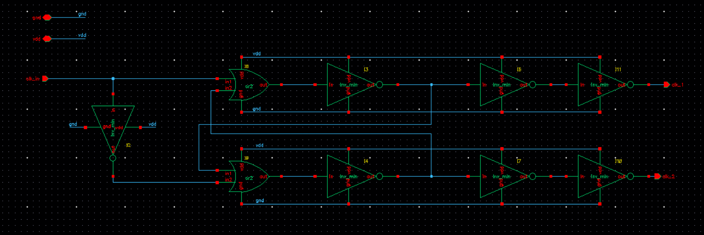

**2 phase clock generator symbol**

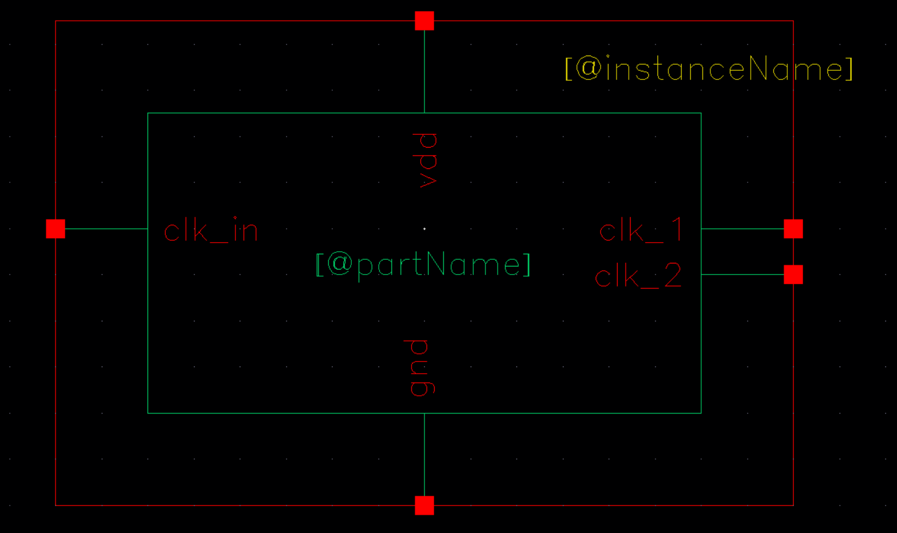

**Clk test schematic**

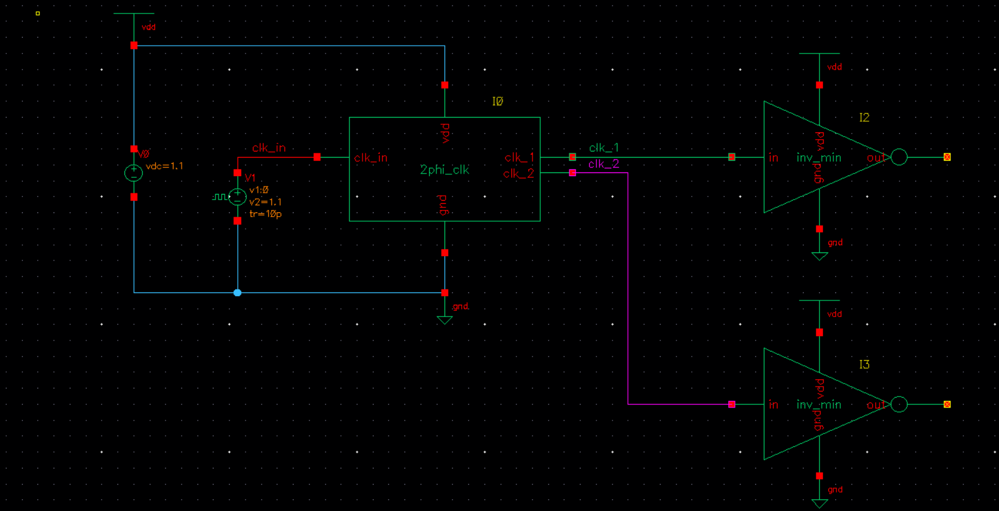

**Clock output waveforms**

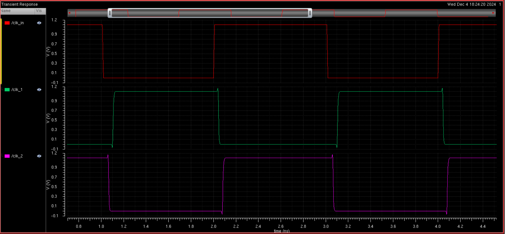

As seen, from the output waveform, it is clear to see that two clock signals are being generated from the one input clock signal, and the clock 1 and clock 2 signals are nonoverlapping and out of phase, as wanted for a non-overlapping clock

## SRAM column driving periphery circuits:

### Tri State buffer/inverter

**Tri state buffer schematic**

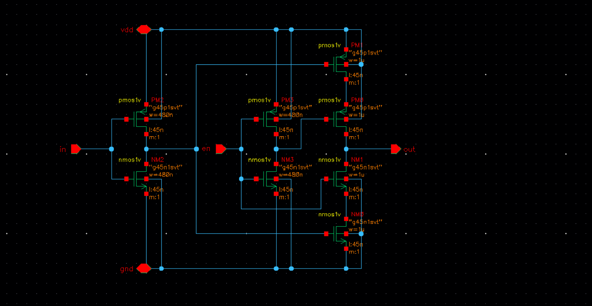

**Tri-state Buffer symbol**

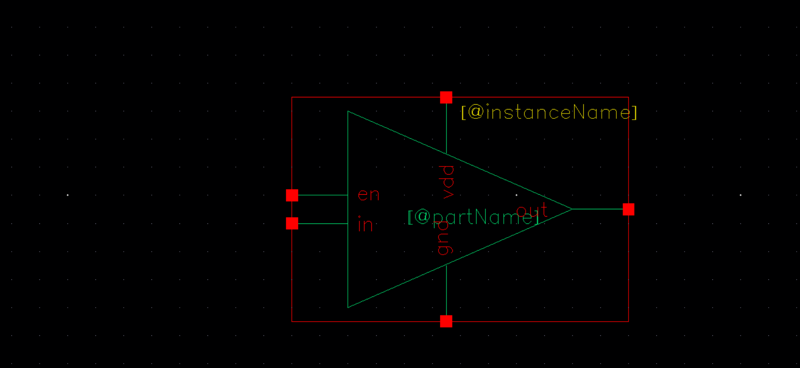

**Tri-state inverter schematic**

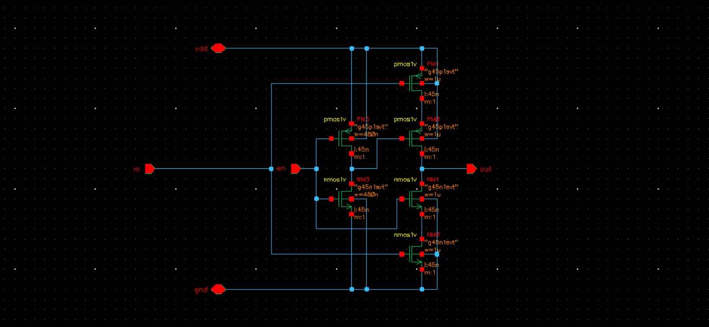

**Tri-state inverter symbol**

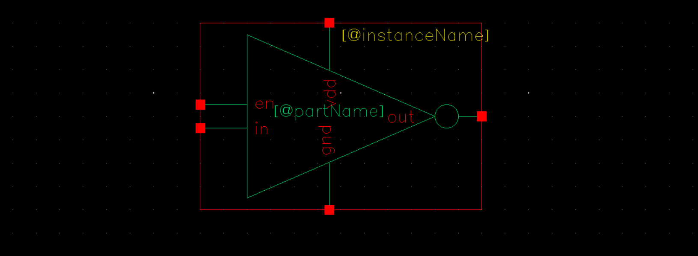

Because the SRAM needs a large drive in order to override the data stored previously, the Tri-state buffer/inverter cannot be minimally sized if correct operation is wanted. Thus they need to be sized. We can perform a parametric sweep on the widths of the output stage of the buffer/inverter and see the output waveform on our SRAM test to see which width can drive data properly. The parametric sweep of the widths is performed below.

**Sizing for drive for the SRAM test**

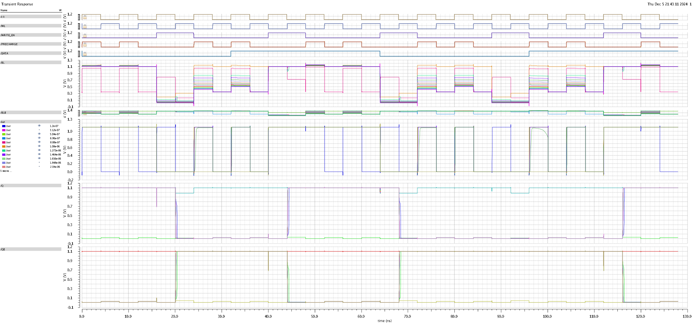

Because the sram is a large load, a minimally sized tri-state buffer is not enough to drive the bitline columns for the SRAM cell. Thus, we must size the tri-state buffer such that it has enough drive to load data onto the line. To do this, we size the 4 transistors in series in the buffer/inverter because they are like cascaded drivers, and the one at the end needs to be the largest. We assign the width the variable W and sweep the width to find which one provides the largest signal to the bitline that we can read and amplify to match the data inputs. After a parametric sweep, we find the best sizing for the drive is **1u**, which can be seen in the images before. Now, we can drive data onto our SRAM. This is the width where the bitline has values above .550V for high data and under .55V for low data.

## SRAM

**6T SRAM design**

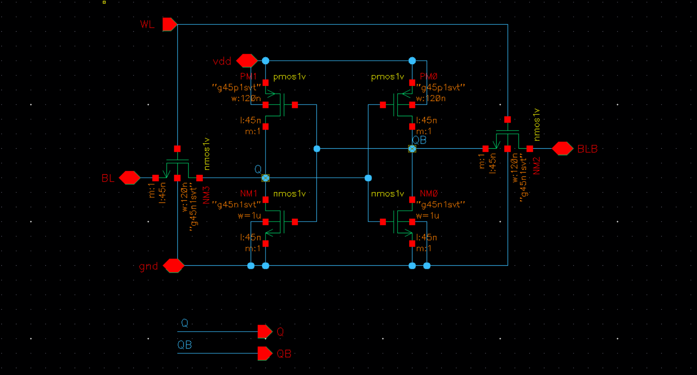

**6T-SRAM symbol**

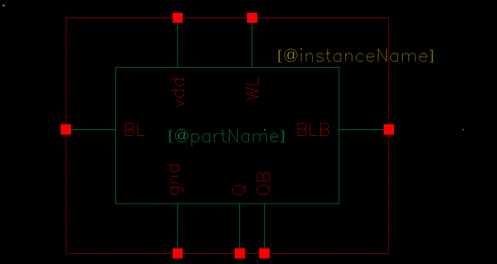

**Sram cell Schematic**

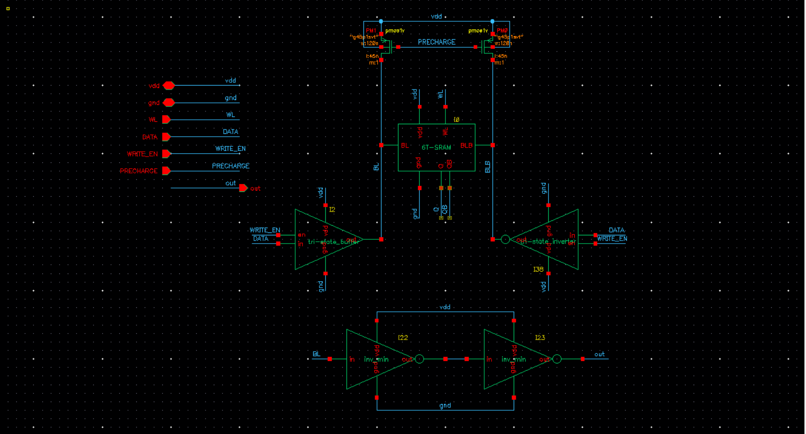

**SRAM cell symbol**

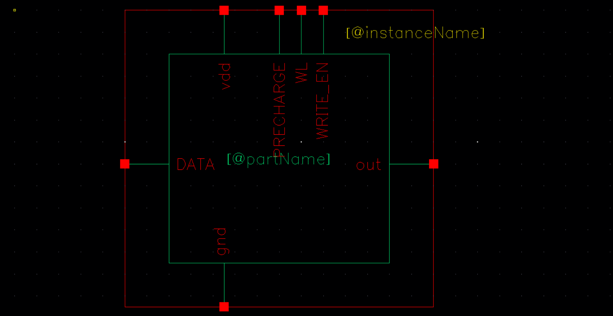

**SRAM test schematic**

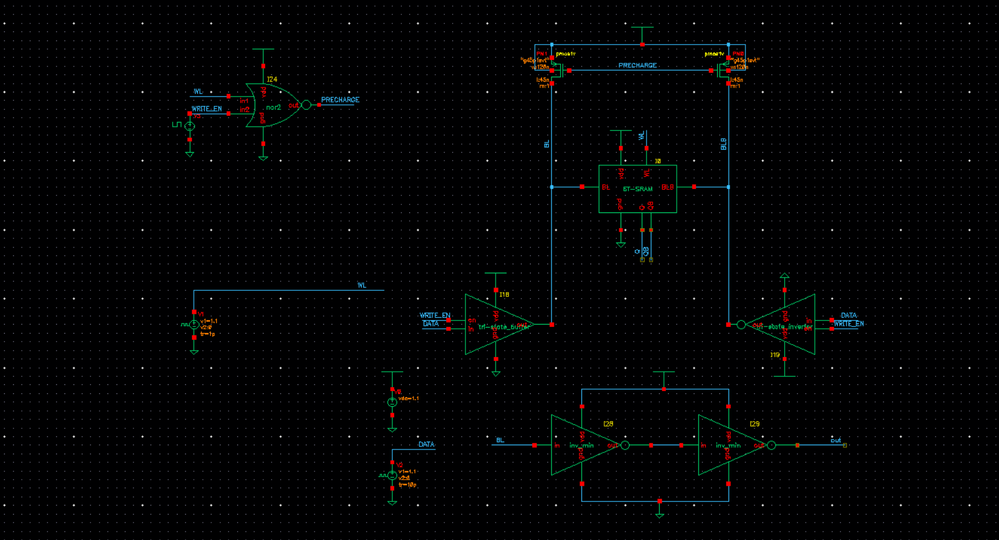

The logic for the SRAM test is outlined above. Additionally, we use two inverters from the bitline to the output in order to provide restoration and act as a sense amplifier between the bitline signal and .55V to amplify the output signal to the rails. For our testing inputs, we use our clock signal to drive the worldline, and have our write enabled at a custom frequency. We want to test the behavior of the precharge in order to make sure it is off when we have to write enable high to confirm it is working. Additionally, when we are reading the data on the bitline should be high when the worldline is low because this is the precharge cycle. Additionally, when we are reading a 0 the output should be pulled low and when we are reading a 1 the bitline should be pulled high, which is then reflected on the output. When we are writing, the bitline/output should always be low when we are writing a 0 because the bitline is being pulled to gnd and high when we are writing a 1. Additionally, the test case was copied from Dr. Khanna’s test case on Ed matches perfectly, so our SRAM functionality is verified.

**SRAM VERIFICATION WAVEFORMS**

**4ns period verification**

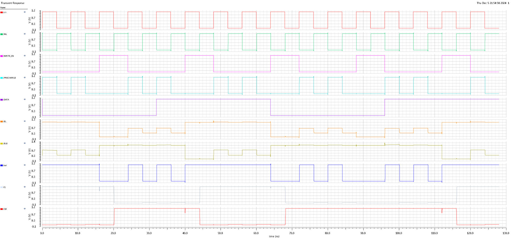

We first test to make sure the SRAM works and As seen the SRAM cell is functioning properly at a 4ns period. The behavior of the output matches the expected behavior outlined above.

Next, we test the faster clock cycles to make sure the SRAM works at higher frequencies.

**1ns period working operation**

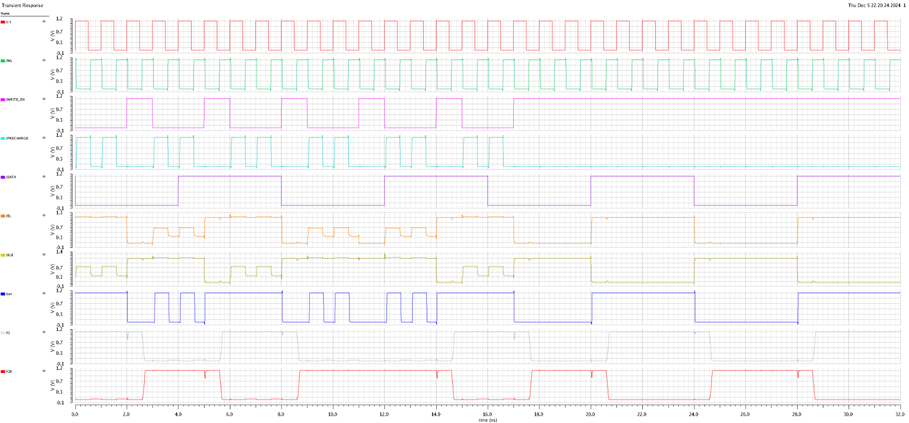

After testing values smaller than 500ps, we find that the max operating speed for the SRAM cell is 500ns for the period.

## Register design

In order to load our data from a serial input bitstream, we need a way to automatically load each bit into a separate SRAM cell. To do this, a register is implemented which loads the data in one clock cycle at a time. The register is SIPO, which takes one serial input and has each bit as a parallel output, and this is created by cascading DFFs. Each DFF is made with D Latches, and the circuits for each are shown below.

## D-Flip Flop (DFF)

**D-Latch Schematic**

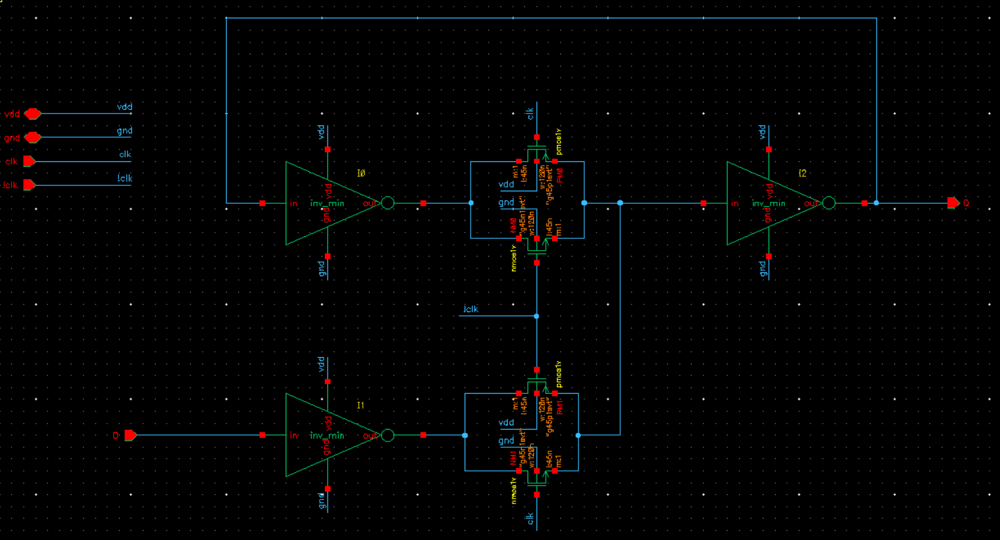

**D-Latch Symbol**

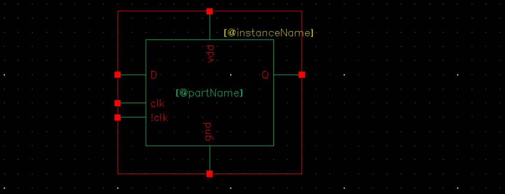

**D-Flip Flop Schematic**

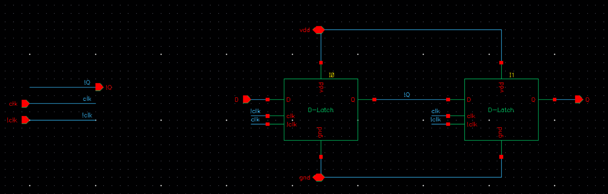

**D-Flip-Flop symbol**

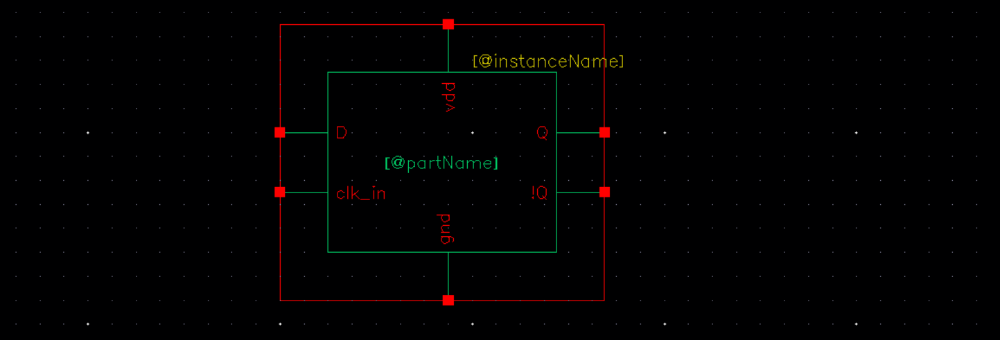

**D-Flip Flop test schematic**

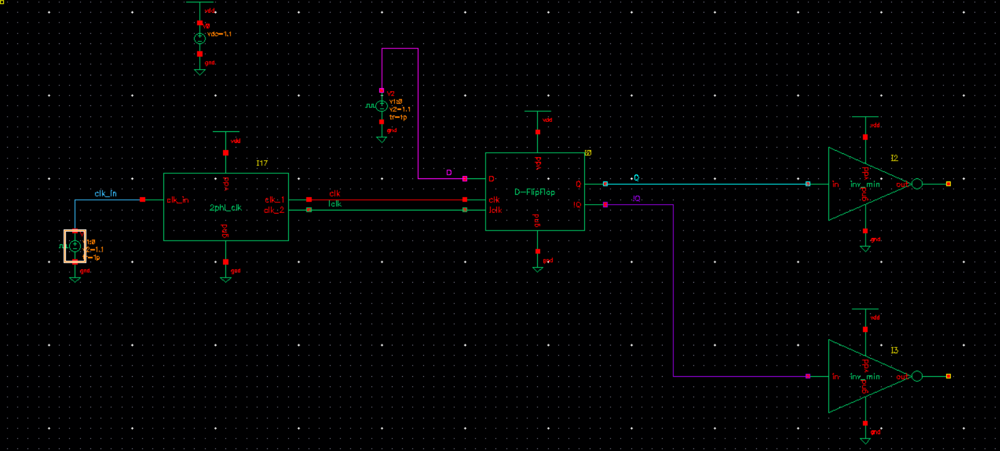

**D-Flip Flop verification**

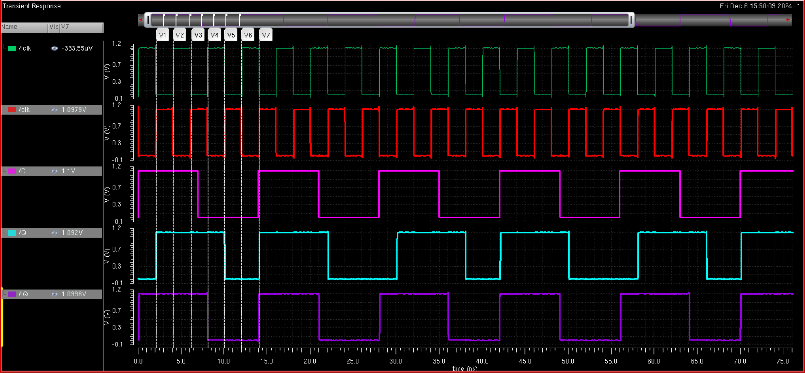

Clock has 4 ns period and data has 7 ns period, as seen when the rising edge of the clock matches with a high value on the data line, the Q output is high and when the rising edge of the clock matches with a low value on the data line, the Q output goes low. Conversely, when the falling edge of the clock is matching with a high value, the !Q output goes high and when the falling edge of the clock matches with a low value on the data line, the !Q output goes low. This is the expected behavior of how a D-flip flop works so verification works.

## Register

We design a Serial In Parallel Out (SIPO) register by cascading 16 D-Flip Flops in series. This is able to shift a 16 bit input so we are able to write to a word of 16 bits.

**SIPO Register schematic**

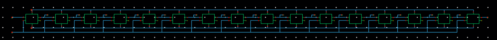

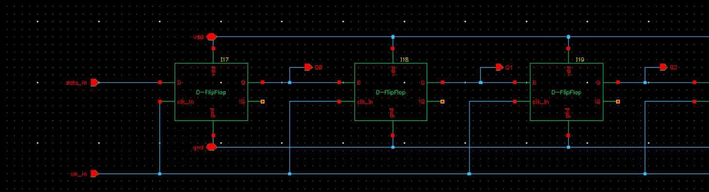

**SIPO register symbol**

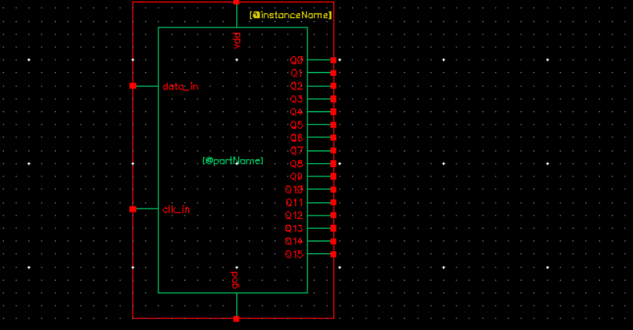

**Register Test schematic**

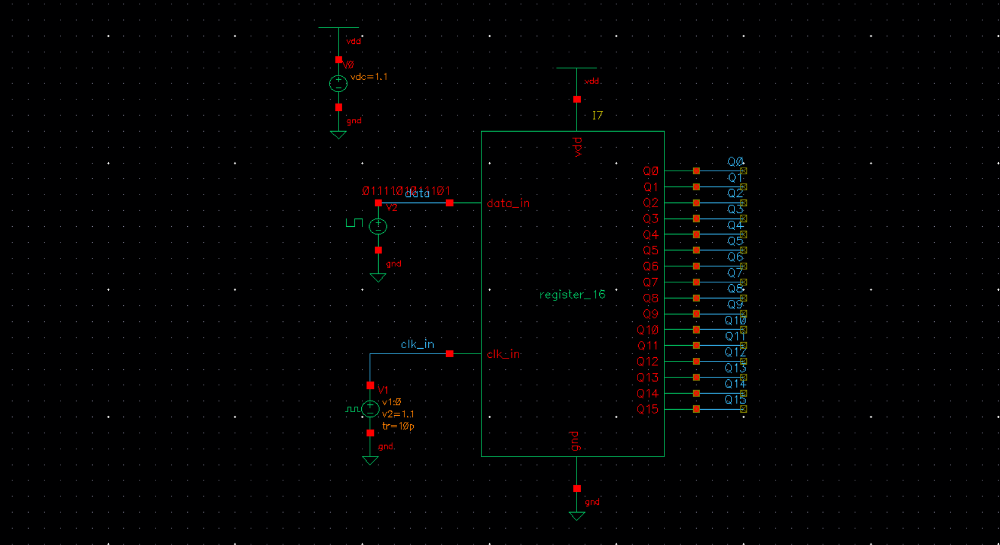

To test the register, we input an arbitrary input waveform and check that the register correctly shifts the input down to the next DFF each clock cycle.

**Output waveforms for register**

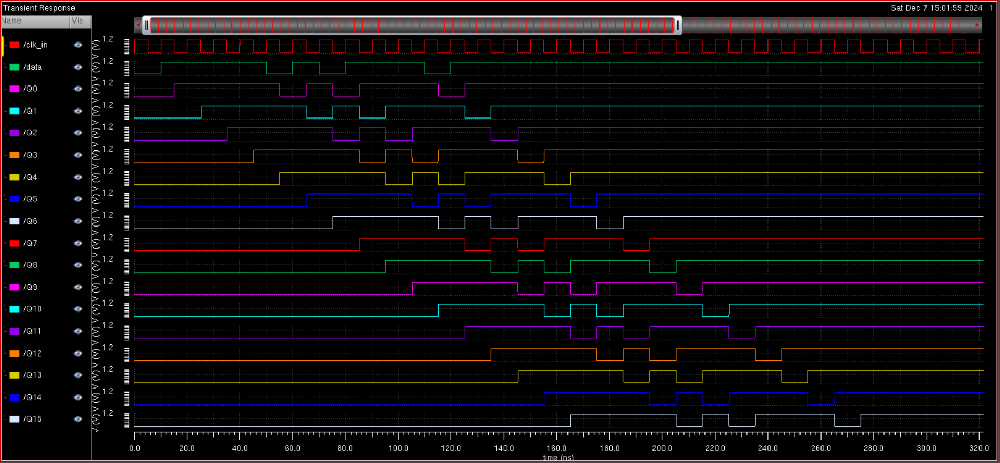

As seen, the register correctly shifts the serial data input down each clock cycle. It is important to note that the first output is shifted from the Data line by half a clock cycle. This is because we found that the Q for our DFF is triggered by the falling edge of the clock cycle. Thus, on the falling edge of the clock the data is passed through the first DFF, which is why everything is shifted by half a clock cycle from the data line. This confirms our register operation.

## SRAM ARRAY

After the register is designed, we can create and test the SRAM array by loading the data into the SRAM array through the register. The schematics for the array are shown below.

**Sram Array schematic**

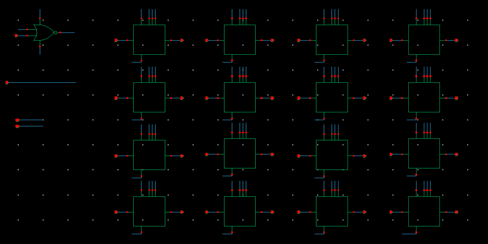

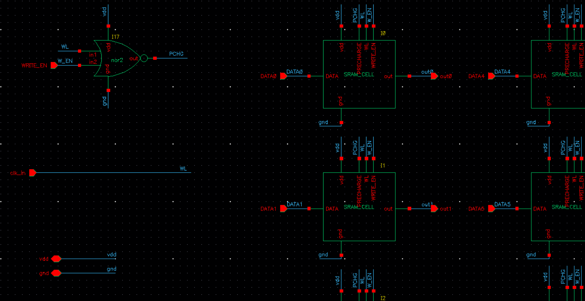

Because all the SRAM share the same precharge timing, we can put some of the periphery circuitry for the precharge logic outside the SRAM cell, which is seen by the nor2.

**Test schematic**

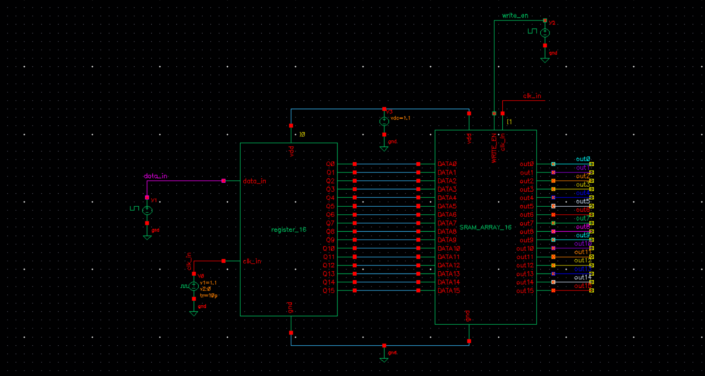

**Data bitstream**

An arbitrary data bitstream with various combinations of bits to test all cases is used to test that the sram is functioning properly. We use a bitstream of **1101111010111010**. In our output, the MSB bit loaded in is the last output of the sram, as expected because the first bit in the datastream goes to the last output of the register. This is reflected in our output waveforms where the last output on the

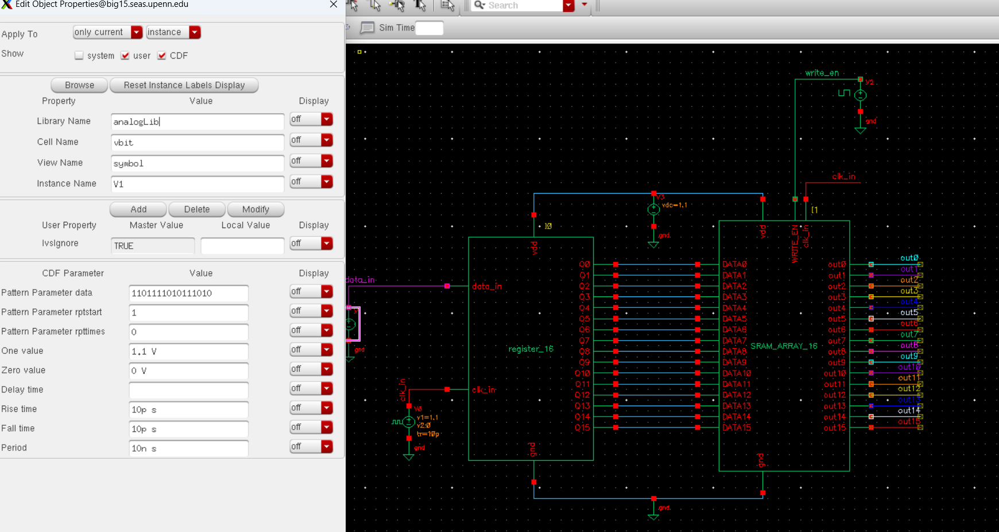

**Output at 10ns clock period**

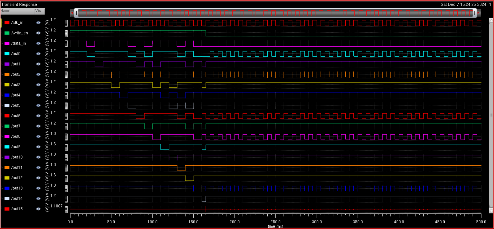

**Output at 1ns clock period**

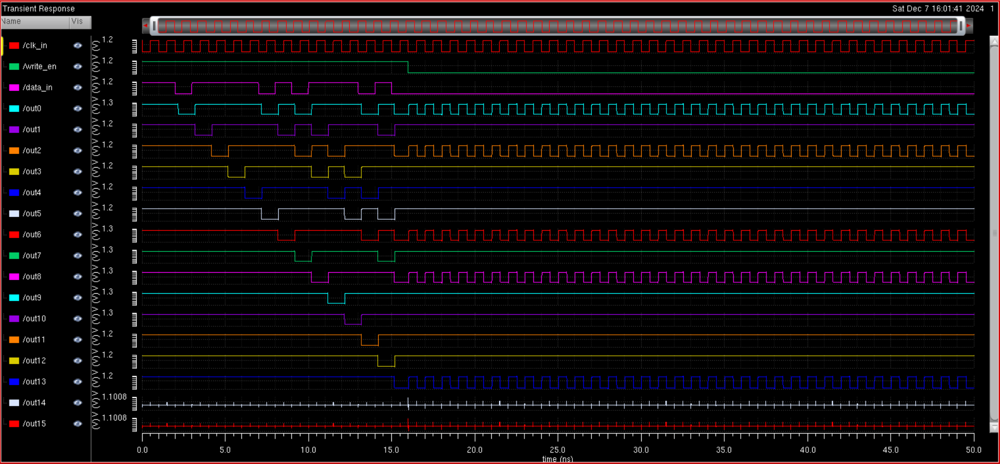

For our test, we load the data into the register and when 16 clock cycles pass, the MSB is loaded into the end of the register. It then gets written into the SRAM array, and when this occurs we switch from the write to read operations. For a high value in the SRAM, we see the output stays flat and for a low value in the SRAM, we see oscillation at the output. The constant/oscillation pattern matches the input bitstream from bottom to the top. Which confirms that the SRAM array is working properly.

## CLB

Finally, we can create the CLB and put the entire design together.

**Final CLB Test schematic**

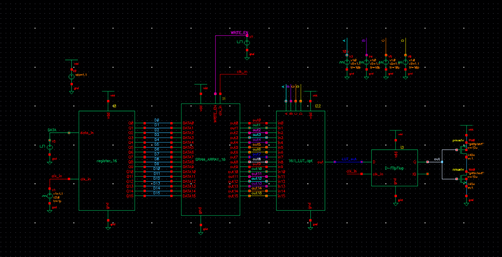

**CLB schematic**

The CLB schematic is the same as the test schematic, but just with the register, SRAM array, LUT, and DFF. ALl the periphery components and circuits and load should not be included.

**CLB output, with LUT cycling from top to bottom**

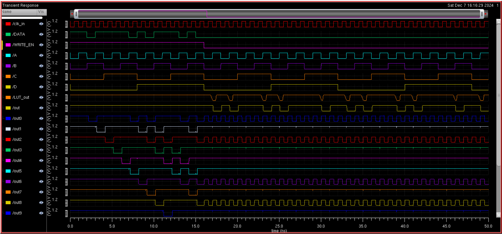

To verify the output is correct, we have to cycle from the bottom to the top of the LUT to make sure our data loading into the SRAM matches the serial data input. However, because the MSB is loaded to the bottom of the LUT, we see the data being written correctly but it is in reverse. Cycling the other way, from the bottom to top, we see that the LUT data gets corrupted, meaning it is not fast enough for the 1ns clock cycle frequency

**CLB output, with LUT cycling from top to bottom at 1ns**

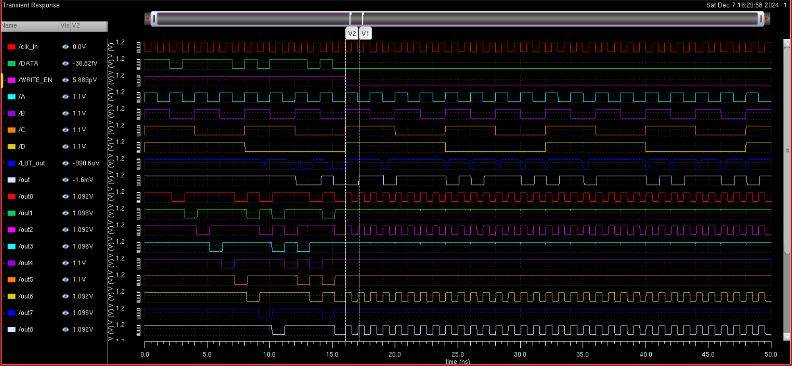

## Optimization - LUT

From our testing, we see that every other component in our CLB works well at a 1ns clock period, but when we add the LUT the data is not perfect. Thus, we know that in order to optimize our design, we need to optimize the LUT since it is the limiting factor. By changing the LUT topology from the one designed in HW 7 by using non inverting MUXs and restoring the output with two inverters at the output. This increases our operating frequency by decreasing delay greatly, because there are less stages of inverters in the LUT. This also decreases our area and energy consumption because we have 26 less transistors (2 less for each MUX and 4 more at the output, which is 26 less because there are 15 MUXs). Through this one optimization, we decrease area and energy, as well as increasing the max operating speed. The optimized LUT design is given below.

**Mux**

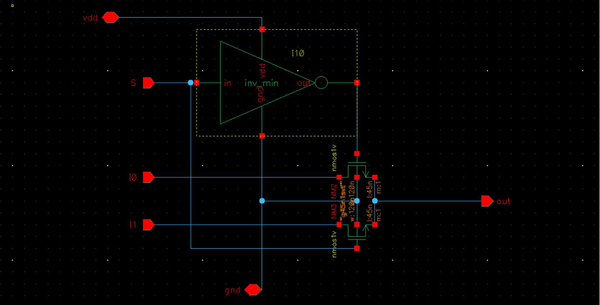

**Optimized LUT**

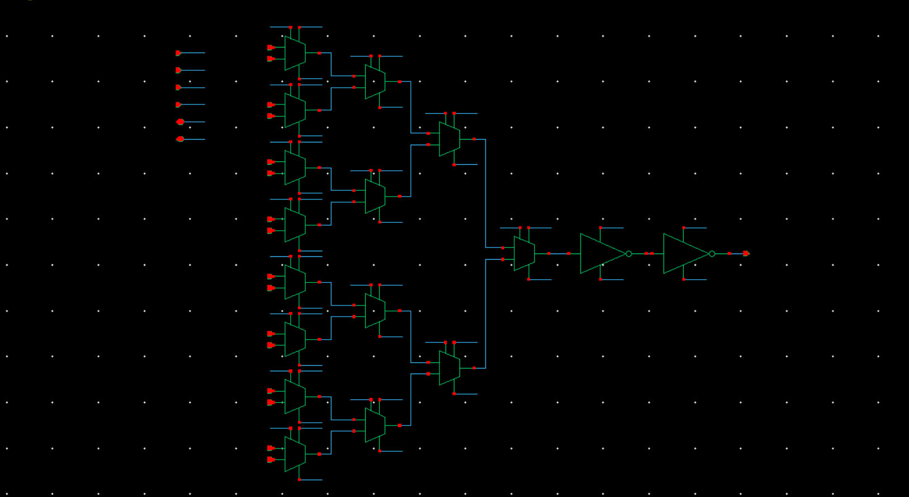

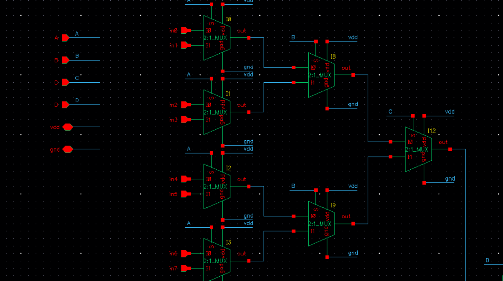

**CLB TESTING, CONT**

After optimizing our LUT to decrease the delay by removing unnecessary inverters every stage, we update the CLB testing schematic to use the optimized LUT. Additionally, to improve our testing design, we delay the LUT to start searching the bits after write_en goes to 0 so we only search through the LUT during the read operation of the SRAM array. This way we can see when the output starts to match the data more clearly.

Note that the data starts one clock cycle after write enable = 0 (reading mode) because the data passes through the DFF on the falling edge.

**1.1 ns period output waveforms**

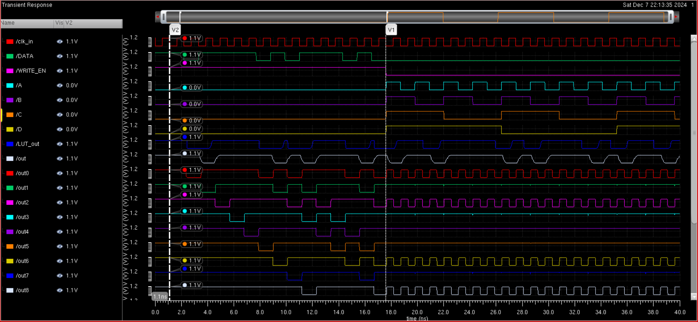

The delay between the start of the search and the output is because it takes one clock cycle for the input to reach the output of the DFF. Interestingly, at this frequency the LUT outputs the correct output even during the write cycle. This may be due to slight changes in the bitline during the writing cycle that are amplified by the restoring inverters, which are reflected at the output of the LUT. The data appearing at the output matches the data bitstream input.

**The functionality of our CLB is verified**

## Max Frequency

After optimizing our design by speeding up the LUT, which was the frequency limiting component. we can now find what the max frequency for correct operation is. Doubling our frequency by halving our period such that we operate at a .5ns period, we find the following result

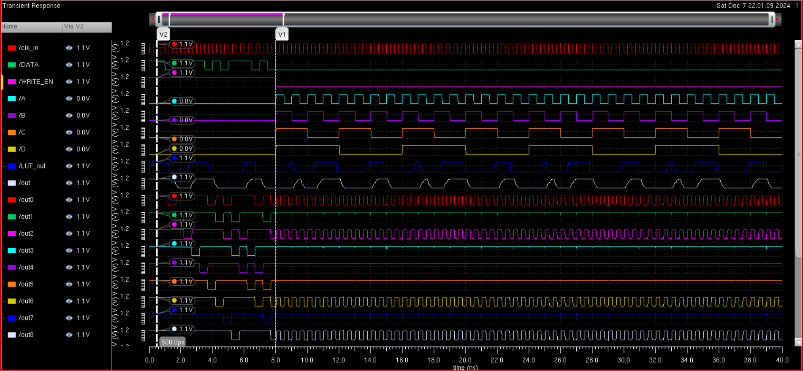

As seen, the LUT is not marching the input data stream at a .5ns period, so this frequency is much too high for correct operation because as can be seen by the output waveform, the output 1 clock cycle after write enable starts does not match the input datastream. Also based on the figure, our data inputs from the SRAM are still functioning properly. We also know the SRAM must be operating properly because based on the tests for the SRAM cell above, we confirmed operation up to 500 ns period, which is not passing the LUT here. Additionally, we know that the flip flop operates properly at this frequency because the data is passing the register and output of the LUT, meaning that our LUT must be the only component not working.

At an 800 ps period our output is still not matching the serial data input, so the frequency is still too high

**800 ps clock period**

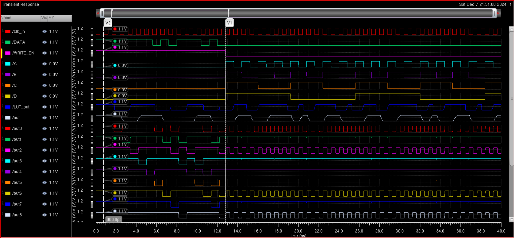

**850 ps clock period**

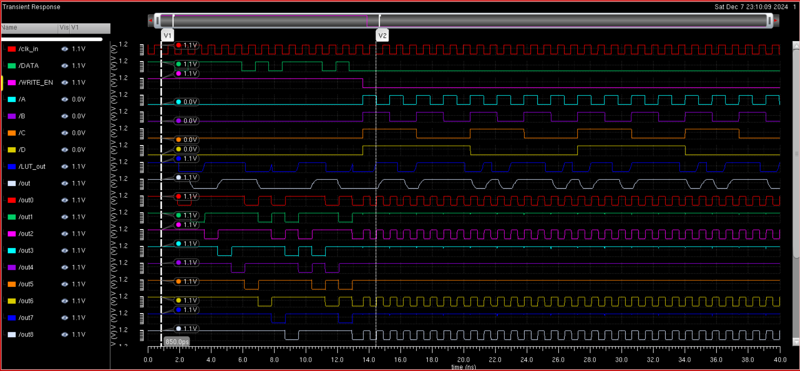

This is our smallest clock period which still gives our output waveform the same data as the serial input. Thus our max operating period for the clock our clock is 850ps, which means our max operating frequency is 1/Tclock = 1.17647GHz

**Max operating frequency = 1.17647GHz**

## Average Energy

Testing an input of 1010101010101010 to find the max loading and active energy.

Using switching data input we get the following waveforms. We can see that the switching appears on the output, as well as the 0 value in SRAM resulting in oscillation and 1 value in SRAM resulting in a flat vdd value. This confirms that our test case is working properly and we can measure the energy.

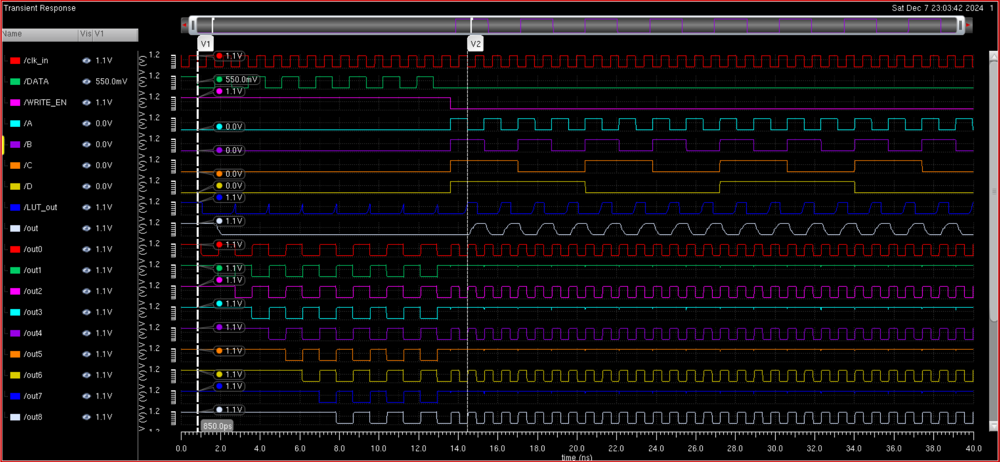

### Loading energy

To find the maximum energy for loading data into the mux, we must find the case of the serial data input that results in the max energy in one sequence. The worst case is when the data is a sequence of 1010101010101010 because the current in the SRAM is the largest when switching. This is because to switch data, a significant amount of current must be supplied by VDD to overcome the data stored in the cross coupled inverter on either of the bit lines during the precharge cycle, which is the only time current is being drawn. All other parts of the SRAM cell have constant current no matter what the cycle is since at all time at least one of the tri-state buffer/inverters will be on and the inverters and the nor2 gate will always be drawing constant power. Knowing this, we confirm that our CLB can take in an input of 1010101010101010 at the maximum switching period, and integrate across the writing period of the SRAM array to find the loading energy. To do this, we integrate from the beginning, when data starts being loaded, to when data gets finished loading, or 16 clock cycles. One clock cycle at maximum frequency is .85 ns, so we integrate the current by vdd from 0 to 13.6ns. Putting into the calculator, we get:

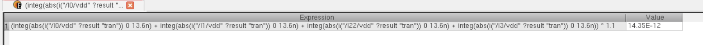

We integrate the current across each of our CLB components (register:I0, SRAM array:I1, LUT:I22, DFF:I3) for the write cycle and multiply by vdd = 1.1V to get the energy for the writing or loading cycle, which comes out to be 14.35 pJ.

**Loading Energy = 14.35 pJ**

### Active energy

Again, the maximum energy case for the active energy, which is cycling through all the bit addresses, the maximum case is alternating 1 and 0. This is because the number of transitions is maximized, which makes the switching energy at the restoring output gates maximized. To do this, we want the data loaded into the LUT to be a sequence of 1 and 0. This happens to be the same test case as previous, so we can use the same input datastream to measure the active energy, but this time we must find the current across the read cycle, when the LUT is cycling through the data inputs. Thus, we integrate the current through all the CLB components from 13.6ns to 27.2ns. Note that this is only the time when the LUT is cycling through the input data, and that the DFF only flips the output after one more clock cycle, but this time of integration is included in the loading energy.

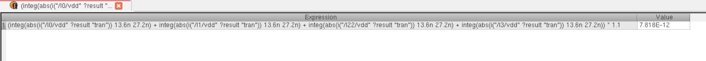

We integrate the current across each of our CLB components (register:I0, SRAM array:I1, LUT:I22, DFF:I3) for the write cycle and multiply by vdd = 1.1V to get the energy for the reading or active cycle, which comes out to be 7.818 pJ.

**Active Energy = 7.818 pJ**

**Average energy**

We assume 20% loading energy and 80% active energy estimate the average energy, so we can calculate the Active energy to be

**Average energy = .2(14.35 pJ) + .8(7.818) = 9.12 pJ.**

## Area

Based on the lab guidelines, the area is calculated by the following formula

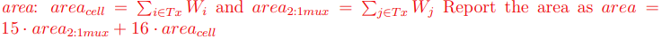

Based on the image of the mux above, one 2:1 mux uses 4 minimum sized transistors, which is 120 nm \* 4 = 480 nm. We have 15 of the 2:1 mux in the design, so our area for the LUT becomes 15 \* 480 = 7200 nm.

The SRAM design shown utilizes the 6T SRAM topology, which is 4 minimally sized transistors with W = 120 nm and two transistors with W = 1u. Thus, we have an area of 16\*(4\*120+2\*1000) = 39680 nm. Thus our total area is given as:

**Area = 7200 + 39680= 46880nm = 4.688E-6m**

## FOM Figure of Merit

Figure of merit (FOM) is given by 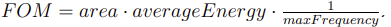

Thus we find:

**FOM = 4.688E-6m \* 9.12E-12 J\*(1/ 1.17647E9 HZ) = 3.634 E-26 m J s**

**FOM = 3.634 E-26 m J s**

## Table of results

| Metric | Max Frequency | Loading Energy | Active Energy | Average Energy | Area                | FOM              |
|--------|---------------|----------------|---------------|----------------|---------------------|------------------|
| Result | 1.17647 GHz   | 14.35 pJ       | 7.818 pJ      | 9.12 pJ        | 46880nm = 4.688E-5m | 3.634 E-25 m J s |

Notes:

All other transistor sizings are visible in the images provided

Inv_min is an inverter with all minimally sized transistors, and the or2 and nor2 logic gates use minimally sized transistors as well

**Nor2 schematic**

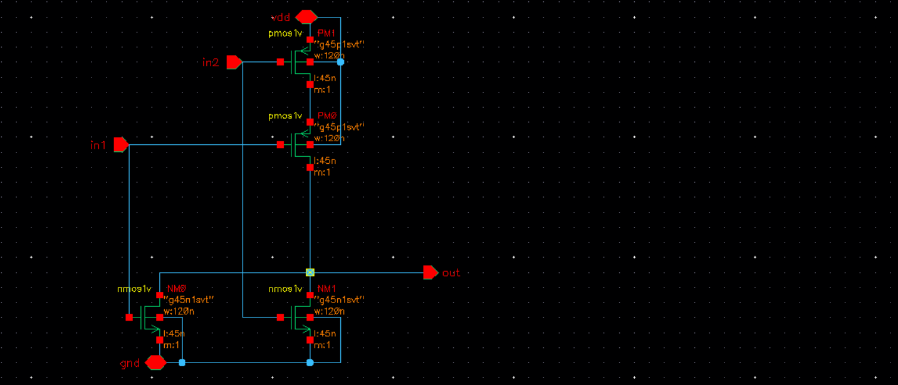

**Or2 schematic**

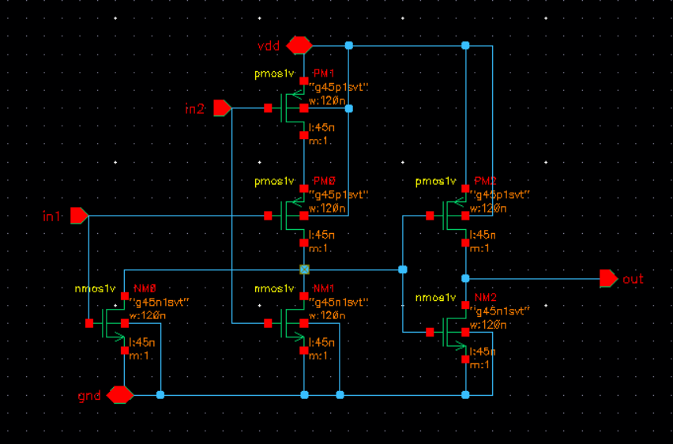
